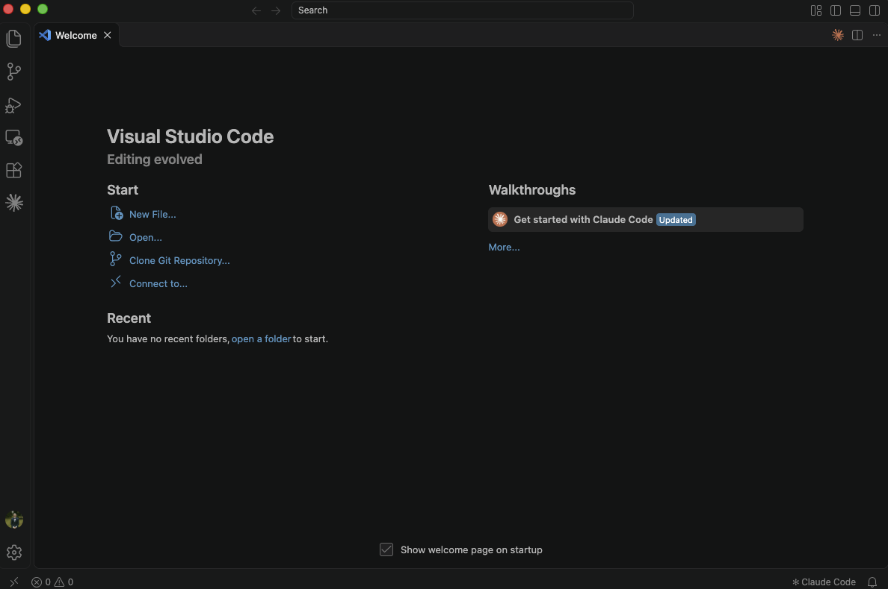

## The Integrated Development Environment (IDE)

When writing software, the most common point of interaction between you and your computer is an
Integrated Development Environment, commonly abbreviated to IDE. Like a filesystem explorer
(e.g. Windows Explorer, MacOS Finder), an IDE will allow you to view and manage files and folders.
However, an IDE also makes it easy to modify files and provides additional capabilities targeted
to writing software, such as support for syntax highlighting and version control of your software.

For our lessons, we will install and use [VSCode](https://code.visualstudio.com/), an IDE developed
by Microsoft. This is chosen because it is both free and popular. There are other IDEs, such as
PyCharm and Cursor, that are similar in these respects that we encourage you to evaluate after the
workshop for your own work.

## Installing VSCode

TODO: ORNL Self Service+ on Windows/Mac/Linux? Point to code.visualstudio.com/download?

Once done, launch the VSCode application. If successfully installed, you should see something similar
to the following screenshot.

{alt="Screenshot of VSCode's default homepage."}

## Getting Started with VSCode

Now that you have installed VSCode, you should spend some time becoming familiar with it.
If you are new to it, and especially if you are new to IDEs in general, we strongly recommend
watching [VS Code for Absolute Beginners | 2026](https://www.youtube.com/watch?v=lWEKiak0WVU).

:::::::::::::::::: callout

## AI Features in VSCode

By default, a new installation of VSCode will have built-in AI features enabled, and we recommend
you turn them off initially. The VS Code for Absolute Beginners video has instructions for doing this
at timestamp 42:47.

::::::::::::::::::
